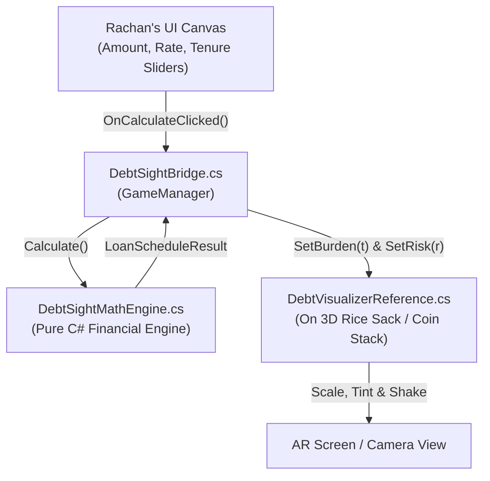

# DebtSight — Complete Unity & Android AR Developer Guide

This guide is for **Rachan (UI)**, **Rakesh (Unity AR)**, and **Parthiv (Coordination)**, prepared by **Revanth**.
It walks you step-by-step from an empty Unity Hub project to building and running the working `DebtSight.apk` on Android using Revanth's C# mathematics and AR bridge.

---

## Architecture Flow



---

## Phase 1: Unity Project Setup (Initial 10 Minutes)

### 1. Unity Version & Template
1. Open **Unity Hub**.
2. Click **New Project**.
3. Recommended Editor: **Unity 2022.3 LTS** (or 2021.3 LTS / Unity 6).
4. Template: Select **3D (URP)** or standard **3D (Core)**.
5. Project Name: `DebtSight-App`.
6. Location: Inside the repository's `App/` directory (or workspace root).

### 2. Switch Platform to Android
1. Go to **File -> Build Settings**.
2. Under Platform, select **Android**.
3. Click **Switch Platform** (bottom right). Wait for Unity to import Android assets.

### 3. Install AR Packages via Package Manager
1. Go to **Window -> Package Manager**.
2. Set filter to **Unity Registry** (top-left dropdown).
3. Search and install:
   - **AR Foundation** (v5.x or v4.x matching your Unity version).
   - **Google ARCore XR Plugin** (enables AR camera on Android).

### 4. Configure Project Settings for AR
1. Go to **Edit -> Project Settings -> XR Plug-in Management**.
2. Select the **Android** tab (little Android robot icon).
3. Check the box for **Google ARCore**.
4. Go to **Edit -> Project Settings -> Player -> Android tab**:
   - **Other Settings -> Identification -> Minimum API Level**: Set to `Android 8.0 'Oreo' (API level 26)` or `Android 7.0 'Nougat' (API level 24)`.
   - **Configuration -> Scripting Backend**: Set to **IL2CPP**.
   - **Target Architectures**: Check **ARM64** (uncheck ARMv7, required by modern Google Play).

---

## Phase 2: Import Revanth's C# Scripts

1. In your Unity Project window, under `Assets/`, create a new folder:
   `Assets/Scripts/DebtSight/`
2. Copy the 4 C# files from the repository's [`Shared/csharp/`](../Shared/csharp/) folder into `Assets/Scripts/DebtSight/`:
   - `DebtSightMathEngine.cs`
   - `IDebtVisualizer.cs`
   - `DebtVisualizerReference.cs`
   - `DebtSightBridge.cs`
3. Switch back to Unity; Unity will compile them automatically with zero errors!

---

## Phase 3: Rakesh's Setup — AR Scene & 3D Object

### 1. Setup the AR Camera & Origin
1. In the Hierarchy, delete the default `Main Camera`.
2. Right-click in the Hierarchy -> **XR -> XR Origin (AR)**.
   *(This automatically creates an XR Origin with an AR Camera attached).*
3. Right-click in the Hierarchy -> **XR -> AR Session**.

### 2. Setup Plane Detection & Raycasting
1. Select the **XR Origin** in the Hierarchy.
2. In the Inspector, click **Add Component**:
   - Add **AR Plane Manager** (detects flat floors/tables).
   - Add **AR Raycast Manager** (enables touch tapping on the floor).
3. Under `AR Plane Manager`, create a default plane prefab:
   - Right-click in Hierarchy -> **XR -> AR Default Plane**.
   - Drag it from Hierarchy into your `Assets/Prefabs/` folder, then delete it from the Hierarchy.
   - Drag this prefab into the **Plane Prefab** slot of `AR Plane Manager`.

### 3. Setup the 3D Visualizer Object (Rice Sack / Coin Stack)
1. Import your 3D Rice Sack or Coin Stack model (or create a 3D Cube as a temporary placeholder).
2. Attach the script [`DebtVisualizerReference.cs`](../Shared/csharp/DebtVisualizerReference.cs) to the 3D object.
3. In the Inspector of `DebtVisualizerReference`:
   - Drag the 3D model's Mesh Renderer into the **Target Renderer** slot.
   - Set **Min Scale** to `(0.3, 0.3, 0.3)` and **Max Scale** to `(1.5, 1.5, 1.5)`.
   - Safe Color is natural burlap (`#E6D9B3`), Danger Color is dark charred red (`#330D0D`).

---

## Phase 4: Rachan's Setup — The Low-Literacy UI

### 1. Canvas Setup
1. Right-click in Hierarchy -> **UI -> Canvas**.
2. On the Canvas component:
   - **Render Mode**: `Screen Space - Overlay`.
   - **Canvas Scaler -> UI Scale Mode**: `Scale With Screen Size`.
   - **Reference Resolution**: `1080 x 1920` (standard vertical mobile).
   - **Match**: `0.5` (balance Width and Height).

### 2. Create the Three UI Panels
Inside the Canvas, create 3 child UI Panels:

1. **Input Panel (`LoanInputPanel`)**:
   - **Amount Field**: `TMP_InputField` for principal (default: ₹50,000).
   - **Interest Rate Field**: `TMP_InputField` (e.g. 3.0).
   - **Rate Period Dropdown**: `TMP_Dropdown` with options: `Monthly (vaddi)` vs `Annual (p.a.)`.
   - **Tenure Slider**: Slider from 1 to 36 months, with a Text showing `"12 Months"`.
   - **Lender Type Selector**: 3 Toggle chips: `Bank / MUDRA`, `SHG`, `Informal Moneylender`.
   - **Income Bracket Selector**: 4 Chips: `< ₹10k`, `₹10k–₹25k`, `₹25k–₹50k`, `> ₹50k`.
   - **"See Your Debt" Button**: Tapping this calculates the loan and reveals the AR view.

2. **Results Banner (`ResultsOverlayPanel`)**:
   - Displays:
     - Monthly EMI: `₹5,666.67`
     - Total Interest: `₹18,000`
     - Formal Comparison Savings: `"You save ₹12,000 with a Bank/SHG loan!"`

3. **Timeline Slider Panel (`TimelinePanel`)**:
   - Placed at the bottom of the AR screen.
   - A horizontal slider with range `0` to `Tenure - 1`.
   - When the user drags the slider, the month label updates (`"Month 6: Remaining ₹25,000"`), and the 3D rice sack dynamically shrinks or shakes based on that month's balance!

---

## Phase 5: Hooking Everything Together with `DebtSightBridge`

1. In the Hierarchy, create an empty GameObject named `DebtSightManager`.
2. Attach [`DebtSightBridge.cs`](../Shared/csharp/DebtSightBridge.cs).
3. In the Inspector:
   - Drag your 3D visualizer GameObject into the **Visualizer Object** slot.
4. In your UI controller script (e.g., `LoanUIController.cs`), wire up the events:

```csharp
using UnityEngine;
using TMPro;
using UnityEngine.UI;
using DebtSight;

public class LoanUIController : MonoBehaviour
{
    public DebtSightBridge bridge;

    [Header("Input Controls")]
    public TMP_InputField amountInput;
    public TMP_InputField rateInput;
    public TMP_Dropdown periodDropdown;
    public Slider tenureSlider;
    public TMP_Dropdown lenderDropdown;
    public TMP_Dropdown incomeDropdown;

    [Header("Output Displays")]
    public TextMeshProUGUI emiText;
    public TextMeshProUGUI interestText;
    public TextMeshProUGUI savingsText;
    public Slider timelineSlider;
    public TextMeshProUGUI timelineMonthText;

    public void OnCalculateClicked()
    {
        // 1. Pass UI values into Bridge
        bridge.currentInput.principal = float.Parse(amountInput.text);
        bridge.currentInput.interestRate = float.Parse(rateInput.text);
        bridge.currentInput.ratePeriod = (RatePeriod)periodDropdown.value;
        bridge.currentInput.tenureMonths = (int)tenureSlider.value;
        bridge.lenderType = lenderDropdown.value;
        bridge.incomeBracket = incomeDropdown.value;

        // 2. Run calculation
        bridge.Recalculate();

        // 3. Display results
        emiText.text = $"₹{bridge.currentSchedule.monthlyPayment:N0}/mo";
        interestText.text = $"Total Interest: ₹{bridge.currentSchedule.totalInterest:N0}";
        
        float savings = bridge.GetComparisonInterestSavings();
        savingsText.text = savings > 0 ? $"Switching to an SHG saves ₹{savings:N0}!" : "Great rate!";

        // 4. Setup timeline slider
        timelineSlider.minValue = 1;
        timelineSlider.maxValue = bridge.currentSchedule.monthlyBalance.Count;
        timelineSlider.value = 1;
    }

    public void OnTimelineSliderChanged(float monthVal)
    {
        int monthIndex = (int)monthVal - 1;
        bridge.ScrubTimeline(monthIndex);
        float balance = bridge.currentSchedule.monthlyBalance[monthIndex];
        timelineMonthText.text = $"Month {monthVal}: ₹{balance:N0} Left";
    }
}
```

---

## Phase 6: Fast Testing in Unity (Without Building APK)

You do **not** have to export an APK every time you test!

1. In Unity, go to **Window -> XR -> AR Foundation -> XR Environment**.
2. Open the **XR Environment view** and choose a simulated room (e.g., *Living Room*).
3. Press the **Play** button in Unity!
4. You can use `W/A/S/D` and mouse to walk around the simulated room, right-click to simulate plane detection, tap the floor to place the rice sack, and test all UI sliders in real-time.

---

## Phase 7: Building the Android `.apk`

When you are ready to test on a physical Android phone:

1. Connect your Android phone to your PC via USB cable.
2. On your phone: Enable **Developer Options** and turn on **USB Debugging**.
3. In Unity: Go to **File -> Build Settings**.
4. Click **Add Open Scenes** (ensure your main AR scene is checked).
5. Ensure **Android** is the active platform.
6. Click **Build and Run** (or just **Build** to save `DebtSight.apk`).
7. Install `DebtSight.apk` on the phone.
8. Point camera at a flat surface, place the sack, and test the loan calculations live!
